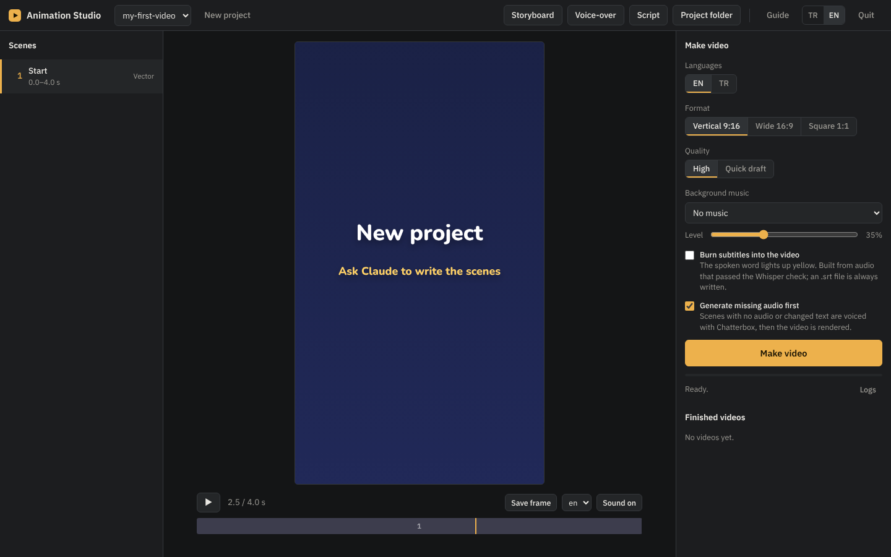

# Animation Studio

A free, local studio for short animated explainer videos (YouTube Shorts, Reels, TikTok).
Claude writes the animated scenes; the studio on your computer does the rest: live preview,
voice-over, translation, subtitles and the final video. Nothing is uploaded anywhere.



## What it does

- **Three scene styles**, chosen when you create a project:
  - **Vector** (2D): characters, text animation, icons, charts, scene-to-scene morph transitions.
  - **3D**: soft, clay-like lit scenes with shadows, drawn in the browser with Three.js.
    Free `.glb` models (Kenney, Quaternius, Poly Pizza) can be added.
  - **Pixel art**: a real 180×320 pixel canvas scaled up 6×, with a limited palette, dithered
    fades, pixel fonts (Turkish and Polish letters included) and animated sprites.
- Vertical, wide and square formats.
- **Voice-over on your computer** with Chatterbox: built-in voices, or your own voice from a
  20-second recording. The same voice can narrate in 20+ languages.
- **Automatic checking** with Whisper: every generated line is listened to and compared with the
  script, and a line with a skipped word is regenerated.
- **Fit to scene**: audio that runs longer than its scene is sped up slightly or the scene is
  lengthened, so narration never gets cut off.
- **Translation** of narration and on-screen text with a local model.
- **Subtitles**: an `.srt` file for every video, and optional burned-in word-by-word subtitles.
- **Audio mix**: music ducks under speech, and loudness is set to -14 LUFS.
- **Interface in English and Turkish**, with a built-in guide.
- **Updates itself**: when you open the studio it checks this repository. If a newer version is
  there, it asks you, downloads it and restarts. Your projects, voices and settings are kept.

## Install

Download the latest installer from the [Releases](../../releases) page.

**Windows (x64)** — run `Animation-Studio-Setup-x.y.z-x64.exe`. The installer is not code-signed,
so Windows shows "Windows protected your PC": choose **More info**, then **Run anyway**. No
administrator rights are needed. Open **Animation Studio** from the desktop icon; the first start
downloads Python and the required packages (2–5 minutes).

**macOS (Apple silicon and Intel, macOS 11+)** — unzip and drag **Animation Studio** into
Applications. The app is not notarized: on first start open **System Settings → Privacy &
Security** and choose **Open Anyway** (on older versions: right-click the app → Open). A Terminal
window downloads what is needed once, then the studio opens in your browser.

On Intel Macs the studio, preview and video rendering work, but the Chatterbox voice-over engine
does not (PyTorch no longer ships Intel macOS builds). You can still upload audio made elsewhere.

### What gets downloaded, and how big it is

| Part | When | Size |
| --- | --- | --- |
| Python and base packages | first start | about 300 MB |
| Chatterbox voice-over | when you press Install Chatterbox | about 10 GB with its model |
| Whisper | first voice-over check | about 1.6 GB |
| Translation model | first translation | about 8 GB |

Voice-over, Whisper and translation run best with an NVIDIA graphics card (8 GB or more) or an
Apple-silicon Mac. Everything except those three works on any recent computer.

## How you use it

1. **Connect Claude to the studio folder.** In the Claude desktop app, start a chat and connect
   the studio folder (`AnimationStudio` in your user folder). Claude reads `CLAUDE.md`, which
   explains how scenes are written.
2. **Describe the video.** For example: *"Using the animation studio in this folder, make a
   40-second vertical video on why octopuses have three hearts. Write the narration in English.
   Propose a storyboard first."* Claude proposes a numbered storyboard, then writes the project
   into `projeler/`.
3. **Open the studio** and pick the project. Preview it, use **Storyboard** to check key frames,
   and tell Claude what to change by scene number.
4. **Voice-over**: install Chatterbox once, choose or record a voice, press **Generate missing**.
5. **Translate** if you want more languages, then generate audio for those too.
6. **Make video.** Finished files are in the project's `cikti` folder.

The **Guide** button in the studio walks through the same steps in more detail.

## Run from source

You need Python 3.11 or newer and Microsoft Edge or Google Chrome.

```
git clone https://github.com/ordinaryboy81/Animation-Studio.git
cd Animation-Studio
pip install -r gereksinimler.txt
python arayuz.py
```

On Windows you can double-click `BASLAT.bat`; on macOS `BASLAT.command` sets up its own Python
environment. The studio opens at http://127.0.0.1:8765.

## Project layout

The code and file names are in Turkish; the interface is bilingual.

| Path | What it is |
| --- | --- |
| `arayuz.py` | the studio: local web server and interface |
| `olustur.py` | renderer: scenes to frames to video, audio mix, subtitles |
| `tts_yonetici.py`, `motor/chatterbox_isci.py` | Chatterbox, Whisper and translation workers |
| `ceviri.py` | translation storage |
| `motor/vektor/vektor.js` | the vector animation engine scenes are written against |
| `CLAUDE.md` | instructions Claude follows when writing scenes (Turkish) |
| `bos_sablon.yaml` | every option a project file (`video.yaml`) can have |
| `projeler/` | your projects (ignored by git) |
| `paket/` | installer sources; `bash paket/build.sh` builds both installers |

## Building the installers

```
bash paket/build.sh
```

Needs `makensis` (NSIS 3), `zip`, `curl` and `unzip`. The results appear in `paket/cikti/`.

## Updates and releases

- The studio compares its `.surum` file with the one on the `main` branch of this repository.
  When `main` has a higher version, the studio offers to update; the notes shown come from
  `degisiklikler.json`. You can also check by hand in **Guide → Check for updates**.
- The update downloads the source of `main`, replaces the program files only (never `projeler/`,
  voices, the Python environment or settings), reinstalls packages if `gereksinimler.txt`
  changed, and restarts the studio.
- To publish an update: change the code, raise the version in `.surum`, add a note to
  `degisiklikler.json`, and push to `main`. Installed studios pick it up on their next start.
- Installers on the Releases page are only needed for new installs. They are built and published
  automatically by `.github/workflows/release.yml` whenever `.surum` changes on `main`. To build
  them by hand: `bash paket/build.sh` (results in `paket/cikti/`).
- Forks can point the updater at their own repository with the environment variable
  `ANIMASYON_DEPO=owner/repo`.

## Things to know

- Voice cloning: only use your own voice or voices you have permission to use.
- YouTube and other platforms restrict mass-produced, low-effort AI content. Bring your own
  topics, research and voice.
- Health or statistics videos should cite their sources; `CLAUDE.md` asks Claude to do this.

## License

MIT, see [LICENSE](LICENSE). Third-party components are listed in
[THIRD_PARTY.md](THIRD_PARTY.md).
